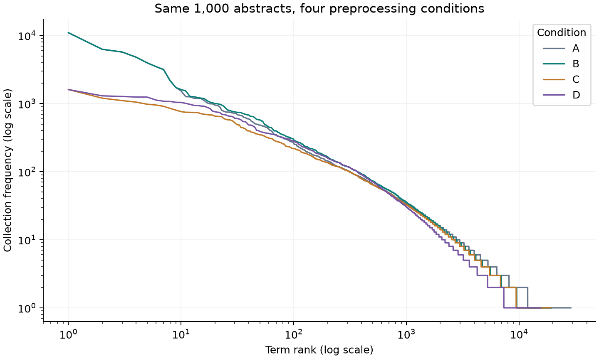
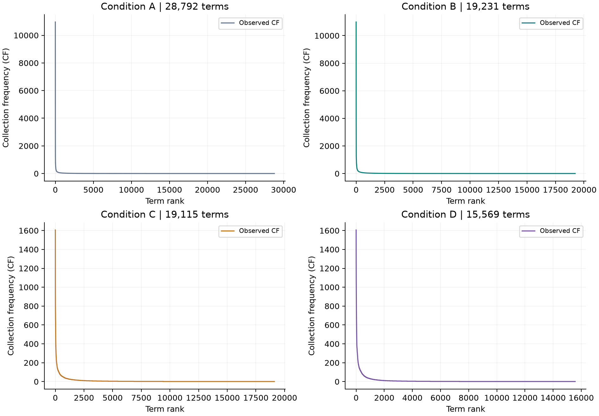
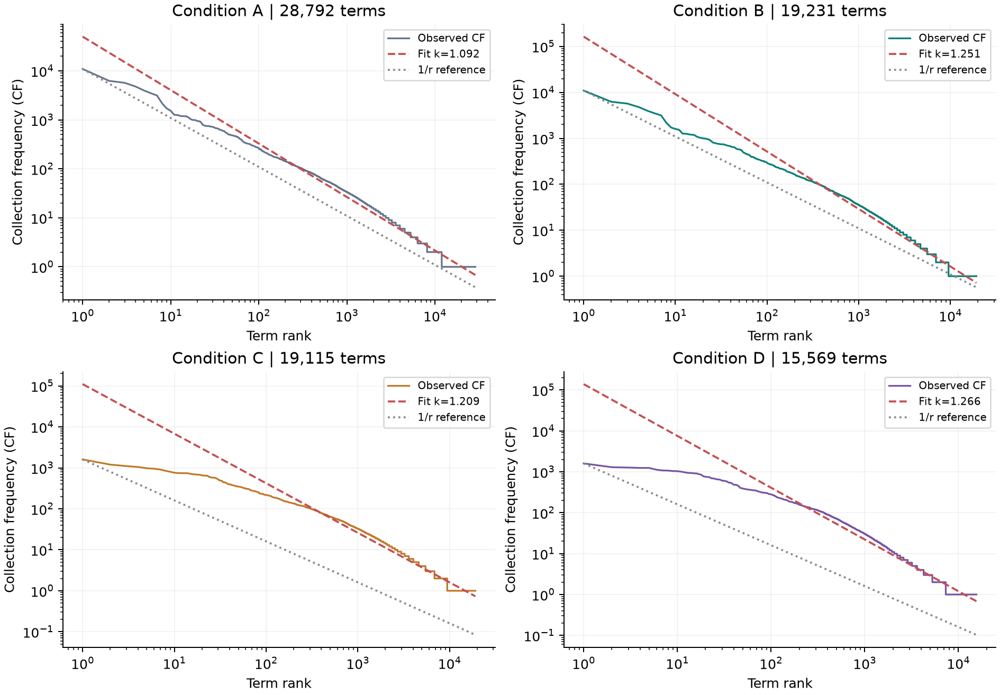
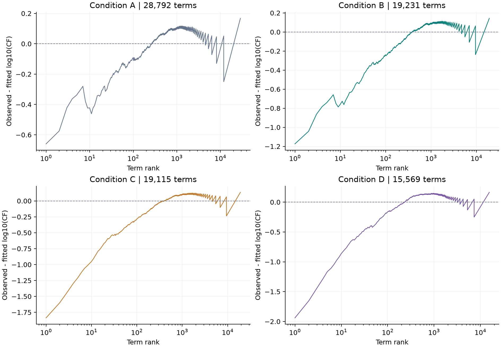
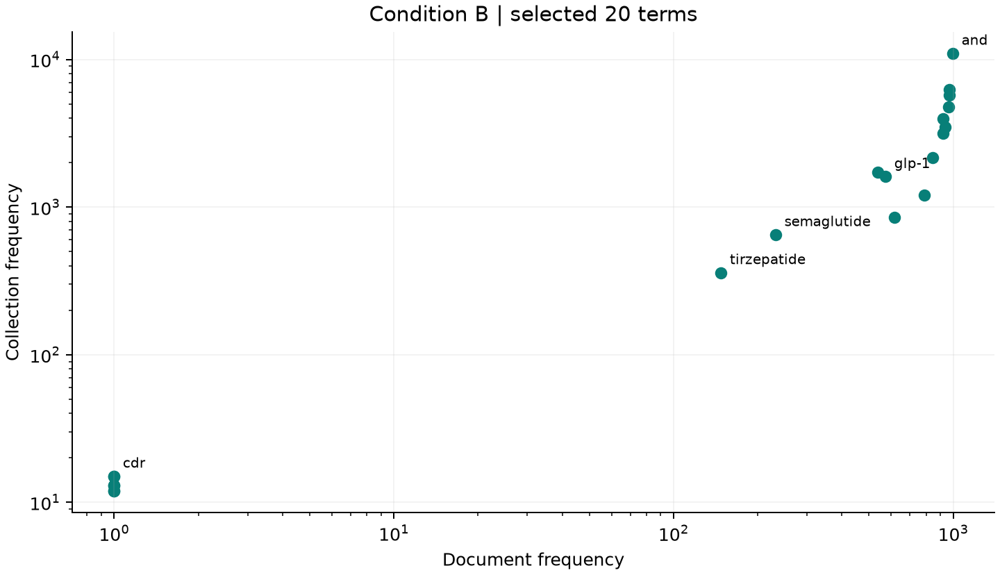
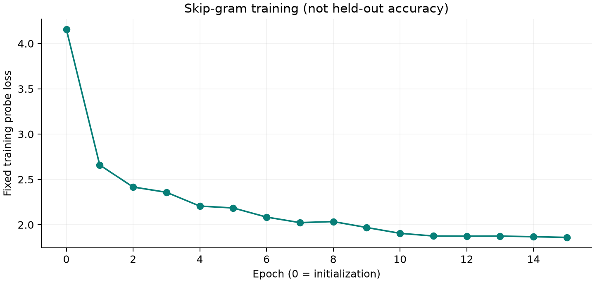

# GLP-1 scientific abstracts: Project 2 report

Corpus: 1,000 English PubMed abstracts. Query: ("GLP-1"[Title/Abstract] OR "glucagon-like peptide-1"[Title/Abstract] OR "glucagon like peptide 1"[Title/Abstract]) AND hasabstract[text] AND english[lang]. The saved selection follows PubMed's returned order, excluding previously archived papers; it is not a random sample. Each PMID is unique and every record has a nonempty English abstract. Only AbstractText content is analyzed, without titles, keywords, section labels or article bodies. Four cumulative conditions use exactly the same raw abstracts. A splits on whitespace and lowercases, keeping attached punctuation. B strips non-alphanumeric boundaries, preserves numeric trailing percent signs and internal punctuation, and normalizes Unicode hyphens/apostrophes. C removes the recorded NLTK English stopword list. D applies the local original Porter 1980 algorithm to ASCII alphabetic tokens. All vocabulary terms are ranked by decreasing CF, with alphabetic tie-breaking. Regression uses unweighted OLS of log10(CF) against log10(rank). Rank regions were fixed before interpreting the fits: first 10%, next 70%, last 20%, with ceiling boundaries. Textbook IDF uses natural logarithms. The corpus snapshot, settings, stopword list, source hashes, exported tables and run metadata support offline reproduction.

Corpus fingerprint: `43be97743f89d09e7e8821d116d4a352d3b9b9527196180be215b8a420dd1de1`

| Condition | Tokens | Vocabulary | Average tokens/doc | k | R² | RMSE (log10) |
|---|---:|---:|---:|---:|---:|---:|
| A | 245416 | 28792 | 245.416 | 1.0915 | 0.9571 | 0.1003 |
| B | 243843 | 19231 | 243.843 | 1.2508 | 0.9687 | 0.0975 |
| C | 177052 | 19115 | 177.052 | 1.2095 | 0.9633 | 0.1024 |
| D | 177052 | 15569 | 177.052 | 1.2663 | 0.9613 | 0.1101 |















## RQ1 — Does the corpus follow Zipf?

The rank-frequency curves have a high-frequency head and a long rare-term tail, with an approximately linear middle on log-log axes. For condition B, the full-vocabulary fit has R²=0.9687 and log10 RMSE=0.0975. The exponent differs from the idealized value 1; the corpus is Zipf-like rather than an exact 1/r distribution. Among predefined regions with nonconstant frequencies, Head (0–10%) has the smallest log-space RMSE (0.0411, R²=0.9900). The complete regional table and residuals show where the approximation changes. R² alone is insufficient: it measures a descriptive OLS fit after a logarithmic transformation. Ranked observations are dependent, many tail frequencies are tied, and no competing distribution or formal power-law goodness-of-fit test is evaluated. Constant tails have undefined R², not proof of an exact law.

## RQ2 — What is the empirical exponent?

With log10(CF)=a+m*log10(rank), k=-m. Full-vocabulary estimates are A: 1.0915, B: 1.2508, C: 1.2095, D: 1.2663. Condition B has slope -1.2508, intercept 5.2149, and k=1.2508. The estimate depends on preprocessing and the fitted rank range. The 1/r reference is anchored to the most frequent term; it is not the fitted regression line.

## RQ3 — How does preprocessing affect the distribution?

A contains 245,416 tokens and 28,792 distinct terms. Boundary punctuation normalization reduces vocabulary to 19,231 in B, while retaining internal punctuation in biomedical identifiers such as GLP-1. Stopword removal reduces tokens from 243,843 to 177,052; vocabulary becomes 19,115. Porter then reduces vocabulary to 15,569 (18.55% below C), with 177,052 retained tokens. Punctuation merges surface variants, stopwords reshape the head, and stemming combines morphological forms throughout the curve. Neither a smaller vocabulary nor an exponent closer to one proves better retrieval. Inspect the Top 50 tables and merged forms for specific examples.

## RQ4 — What is the relationship between CF and DF?

CF counts occurrences; DF counts distinct documents. In condition B, 'and' occurs 10,988 times across 997 abstracts, with IDF=0.0030. In contrast, 'cdr' has CF=15, DF=1 and CF/DF=15.00: repetition is concentrated rather than widespread. A paper can repeat a specialized abbreviation many times, raising CF while contributing only one to DF. DF/N directly describes document coverage. Both measures matter: CF captures repetition and processing volume; DF determines postings-list coverage and collection-level discrimination. IDF=ln(N/DF) is smaller for terms occurring in many documents. CF alone cannot determine IDF, because equal CF can have different DF.

## RQ5 — Why does Zipf matter to IR?

Zipf's law matters because an information retrieval system processes a highly uneven vocabulary. In this collection, condition B contains 19,231 distinct terms and 243,843 occurrences. A small head contributes many occurrences, while numerous rare forms occupy the tail. This structure connects language statistics to indexing cost and term weighting. It is an empirical design guide rather than a rule that every biomedical collection must satisfy exactly.

Stopword removal changes the workload substantially: condition C retains 177,052 tokens, compared with 243,843 in B. Common grammatical words often occur in most documents, so their presence provides little evidence that one paper is more relevant than another. Removing them can shorten query processing and positional data. However, frequent words are not automatically useless: phrases, negation, and biomedical concepts may depend on them. The experiment demonstrates changed counts, not an improvement in retrieval effectiveness. Phrase search should therefore preserve the original text and use an explicitly documented matching policy.

For an inverted index, each unique term needs a dictionary entry and a postings list. High-DF terms have long document lists; high-CF terms may also have many stored positions. The long tail creates many short lists and dictionary entries, even when each term has few occurrences. Porter reduces vocabulary from 19,115 to 15,569 between C and D, suggesting a smaller dictionary, but merged lists may become longer. Actual storage also depends on document-ID gaps, position encoding and implementation overhead. Gap-based integer compression and compact dictionaries are relevant design options; this study does not claim measured compression savings.

TF-IDF separates within-document repetition from collection-wide prevalence. Raw TF can reward a term repeated in a document, while IDF=ln(N/DF) discounts terms shared by many documents. A term found in every document has IDF zero under this formula. High CF alone does not imply low IDF: a specialized term can be repeated heavily in only a few abstracts. Comparing CF and DF reveals this distinction. Zipf's head helps explain why frequency alone is an inadequate ranking signal, but DF must be measured independently. Helix keeps BM25 ranking separate from this textbook-IDF analysis. Ultimately, frequency statistics justify concrete experiments on index size, query latency and relevance judgments; they cannot replace those evaluations.

## Final challenge — Why is an approximate law useful?

The four conditions produce different exponents (A: 1.0915, B: 1.2508, C: 1.2095, D: 1.2663), yet all show strongly uneven term frequencies. That robust qualitative structure is useful even though no single exact law explains every rank. It motivates separate treatment of very common terms, compact storage for a large rare-term vocabulary, and weighting based on document coverage. These are engineering hypotheses supported by observed counts, not universal guarantees. This study measures vocabulary reduction and frequency structure; it does not measure compressed index bytes or retrieval relevance. A subsequent evaluation should compare latency, actual storage, and judged search quality before claiming an improvement. The useful lesson is to let the empirical curve guide design, then validate the design against the system's retrieval objective.

## Word2Vec

Skip-gram with negative sampling; condition C; 9,427 words × 64 dimensions. Fixed training probe loss: 4.1575 → 1.8601. PCA 2D retains 24.37% of normalized-vector variance. Training loss and cosine are not retrieval accuracy.

```json
{
  "dimensions": 64,
  "window": 5,
  "min_count": 2,
  "negatives": 5,
  "epochs": 15,
  "learning_rate": 0.025,
  "sample": 0.001,
  "batch_size": 128,
  "seed": 42
}
```



## Limitations

The single-topic, date-ordered sample is not representative of all biomedical language. Boundary-only punctuation handling retains some compound strings and numerical values. Stemming can merge distinct meanings. OLS diagnostics are descriptive, not a formal power-law test. No relevance labels, held-out embedding benchmark, retrieval-quality comparison or actual index-compression benchmark were collected.

## Reproduce

Run `.\.venv\python.exe scripts\run_project2.py`. To replay frozen texts offline, add `--snapshot output/project2_glp1/corpus_snapshot.json`. All source XML remains local.

## Sources

- Course briefs: Homework-2-26-20260922.pdf and project-2-details-20260929.pdf.
- Source corpus: PubMed XML records identified in corpus_snapshot.json and run_metadata.json.
- Algorithm implementations: src/zipf_experiment.py, src/porter.py, src/word2vec.py.
- The exact stopword list and all experiment choices are recorded in analysis.json.

IR implications discussion length: 362 whitespace-delimited words.
## Optional challenge — two domains

Domain B: arXiv computer science: cs.AI, cs.LG, cs.CL, cs.CV, cs.CR, cs.DB, cs.DS, cs.IR, cs.SE, cs.NI (50 newest per primary category). 500 abstracts per domain, condition C.

| Measure | GLP-1 (medical) | Computer science (arXiv) |
|---|---|---|
| Documents | 500 | 500 |
| Tokens | 88036 | 67692 |
| Vocabulary | 12626 | 13001 |
| Zipf exponent | 1.1248 | 1.0385 |
| R2 | 0.9610 | 0.9488 |
| RMSE log10 | 0.0983 | 0.1045 |
| Hapax share | 0.4973 | 0.5140 |
| Top 10 terms | glp-1, receptor, patients, weight, metabolic, obesity, risk, agonists, diabetes, outcomes | model, models, across, data, language, two, show, training, framework, results |

With 500 abstracts per domain under condition C, both rank-frequency curves remain Zipf-like: k = 1.125 (R² 0.961) for GLP-1 (medical) and k = 1.038 (R² 0.949) for Computer science (arXiv), a difference of 0.086. The overall shape is therefore similar, but the details are domain-specific. GLP-1 (medical) has 12,626 distinct terms versus 13,001 for Computer science (arXiv) (49.7% vs 51.4% hapax), and only 17.3% of the combined vocabulary is shared. The top-10 lists share 0 terms (none); the other head terms name each domain's subject (glp-1, receptor, patients, weight, metabolic, obesity, risk, agonists, diabetes, outcomes vs model, models, across, data, language, two, show, training, framework, results). Domain specificity thus changes which terms occupy the head and how large the tail is, while the heavy-tailed form persists. Two single-topic samples cannot establish a general effect size; the exponent also depends on preprocessing and the fitted rank range.
