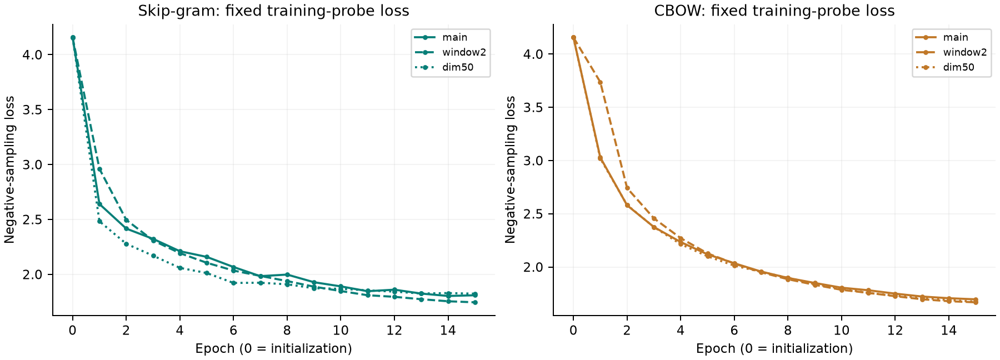
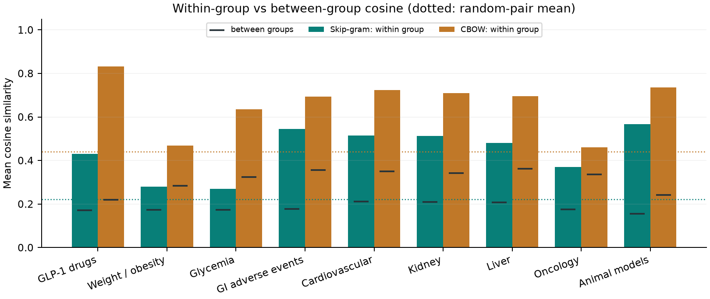
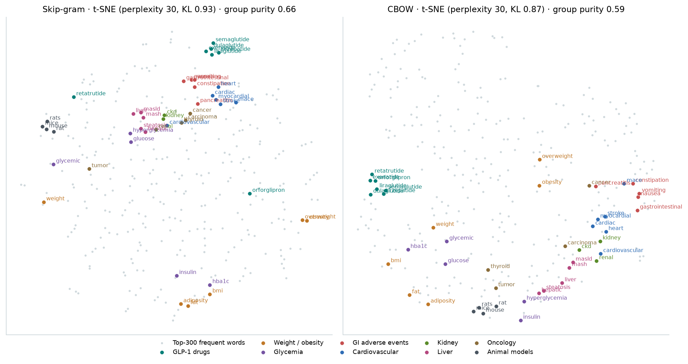
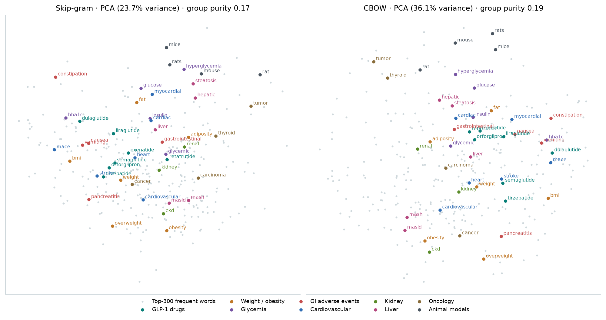
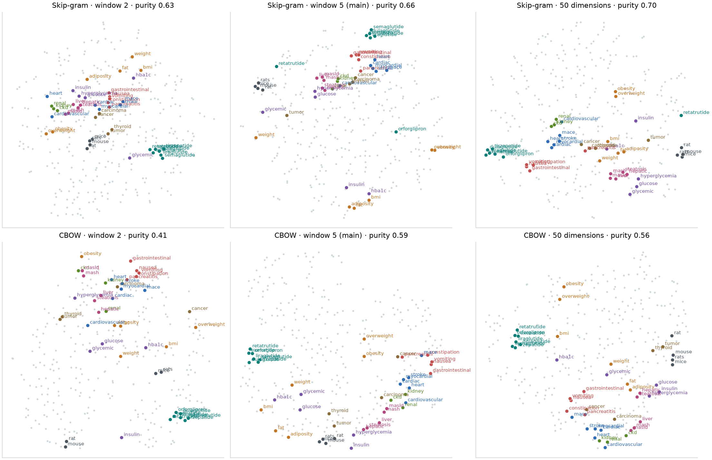
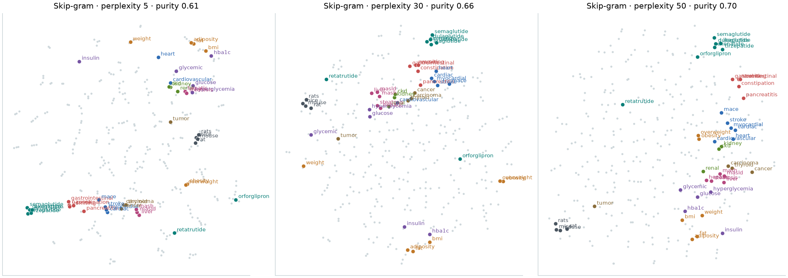
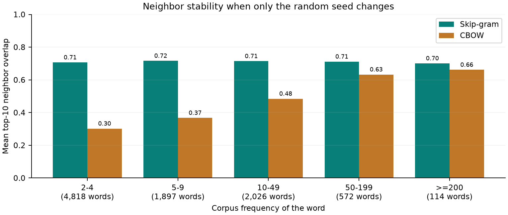

# GLP-1 abstracts: word embeddings with CBOW and Skip-gram

Project 2, part 2 · Biomedical Information Retrieval

**Central question:** can about 1,000 scientific abstracts learn a meaningful semantic representation of words?

**Short answer:** partly. Frequent core terms of the domain form clear, measurable relations in both models: drugs, organs, adverse events. Rare terms are stable only in Skip-gram, and general medical relations that are marginal in the corpus are not learned.

## 1. Data and preprocessing

Corpus: the same frozen 1,000 English PubMed abstracts on GLP-1 used in part 1 (corpus fingerprint 43be97743f89d09e…). Only abstract text is used. Preprocessing is part 1's condition C: lowercasing; whitespace tokenization; punctuation stripped from token boundaries while internal hyphens are kept (glp-1); NLTK English stopwords removed; no stemming. Abstracts are split into sentences and context windows never cross a sentence. Result: 10,680 sentences, 177,052 tokens. With min_count 2 the vocabulary has 9,427 words (167,364 retained tokens). Stopwords were removed because they would dominate every window. The threshold of 2 keeps rare domain terms, so their behaviour can be studied; min_count 5 is tested in RQ4.

Most frequent words: glp-1 (1606), receptor (1200), patients (1104), weight (1050), obesity (977), metabolic (951), risk (911), agonists (848), diabetes (801), treatment (761), clinical (745), outcomes (742), glucagon-like (741), evidence (739), associated (710), peptide-1 (697), 95% (689), 2 (681), disease (678), effects (653).

## 2. Training samples and models

Both models use the same window definition (±5 words). Skip-gram creates one (center → context) pair for every word in the window. CBOW creates one (window → center) example per position, with the window's vectors averaged (word2vec cbow_mean=1). Frequent words are randomly subsampled (t = 0.001) each epoch, so example counts vary slightly between runs. Both are trained from scratch in NumPy (src/word2vec.py) with negative sampling: 5 noise words from the unigram^0.75 distribution, learning rate 0.025 decaying linearly, batch 128, 15 epochs, seed 42. No pretrained vectors are used. The loss is measured on a fixed probe of 2,048 training examples and noise words, not on held-out data.

| Run | Model | Dim | Win. | Min count | Seed | Vocab | Examples / epoch | Sec. | Probe loss |
|---|---|---|---|---|---|---|---|---|---|
| main | Skip-gram | 100 | 5 | 2 | 42 | 9,427 | 1,278,168 | 240 | 4.157 → 1.810 |
| main | CBOW | 100 | 5 | 2 | 42 | 9,427 | 159,776 | 114 | 4.156 → 1.697 |
| window2 | Skip-gram | 100 | 2 | 2 | 42 | 9,427 | 574,866 | 138 | 4.157 → 1.746 |
| window2 | CBOW | 100 | 2 | 2 | 42 | 9,427 | 159,776 | 85 | 4.156 → 1.669 |
| dim50 | Skip-gram | 50 | 5 | 2 | 42 | 9,427 | 1,278,153 | 178 | 4.155 → 1.824 |
| dim50 | CBOW | 50 | 5 | 2 | 42 | 9,427 | 159,717 | 89 | 4.157 → 1.675 |
| mincount5 | Skip-gram | 100 | 5 | 5 | 42 | 4,609 | 1,141,967 | 218 | 4.155 → 1.914 |
| mincount5 | CBOW | 100 | 5 | 5 | 42 | 4,609 | 146,027 | 102 | 4.153 → 1.674 |
| seed7 | Skip-gram | 100 | 5 | 2 | 7 | 9,427 | 1,278,096 | 239 | 4.159 → 1.802 |
| seed7 | CBOW | 100 | 5 | 2 | 7 | 9,427 | 159,780 | 113 | 4.158 → 1.748 |

## 3. Background: CBOW vs Skip-gram

| Property | CBOW | Skip-gram |
|---|---|---|
| Input | The context words in the window (their vectors are averaged into one hidden vector h) | The single center word |
| Prediction target | The center word | Each context word in the window, one at a time |
| Training examples | One example per token position | One example per (center, context) pair: up to 2 × window per token |
| Training speed | Faster: fewer, averaged updates | Slower: many more updates per epoch |
| Rare words | A rare word is one of several averaged inputs, so its own gradient signal is diluted | A rare word is the input for every one of its context pairs, so each occurrence gives it several direct updates |
| Expected behavior | Smoother, high-cosine space; good for frequent words and interchangeable terms | Sharper, more topical neighbors; better for rare and domain-specific terms, but noisier |

**Why might Skip-gram be particularly useful for rare or domain-specific scientific terms?**

Scientific terms such as drug names, gene symbols or abbreviations usually occur only a few times in a small corpus. In CBOW a rare word only enters training as one of up to 2·window context inputs whose vectors are averaged, so its update is shared with the frequent words around it, and as a prediction target only once per occurrence. In Skip-gram the rare word is itself the input for every pair it forms, so each occurrence produces up to 2·window separate gradient updates that pull it toward the actual words around it. The rare word's vector is therefore determined by its contexts rather than by its random initialization. Its neighbors can be traced to specific contexts, which matters when the term is the thing a biomedical user is searching for.
The experiment agrees (RQ1). Under a seed change, Skip-gram keeps 71% of rare-word neighbors, CBOW 30%.

## 4. Nearest neighbors (cosine similarity, top 5)

15 query words; the number in brackets is the corpus count.

| Query | Skip-gram | CBOW |
|---|---|---|
| glp-1 (1606) | ras 0.63, ra 0.60, polypeptide/glucagon-like 0.57, substitution 0.56, cornerstones 0.55 | glp1 0.71, glp-1/gip 0.68, diabetes-labeled 0.63, glp)-1 0.63, croatia 0.60 |
| semaglutide (649) | dulaglutide 0.55, liraglutide 0.48, 2·4 0.44, transitioned 0.43, albiglutide 0.41 | tirzepatide 0.92, liraglutide 0.85, dulaglutide 0.82, subcutaneous 0.78, orforglipron 0.77 |
| tirzepatide (359) | dulaglutide 0.54, liraglutide 0.52, exenatide 0.48, favored 0.48, gip/glp-1 0.47 | semaglutide 0.92, liraglutide 0.85, dulaglutide 0.84, youth 0.84, subcutaneous 0.81 |
| liraglutide (161) | exenatide 0.58, dulaglutide 0.57, tirzepatide 0.52, injection 0.51, semaglutide 0.48 | subcutaneous 0.89, dulaglutide 0.88, orforglipron 0.88, 2·4 0.87, exenatide 0.87 |
| exenatide (23) | lixisenatide 0.85, eudravigilance 0.74, sars 0.73, dose-related 0.69, generalisable 0.68 | lixisenatide 0.97, orforglipron 0.94, retatrutide 0.94, cagrilintide 0.93, tzp 0.92 |
| obesity (977) | overweight 0.55, 2030 0.54, pervasive 0.53, 589 0.53, crisis 0.51 | increasingly 0.87, osa 0.85, pharmacotherapeutic 0.84, obesity-associated 0.84, apnea 0.84 |
| insulin (397) | resistance 0.74, basal 0.63, beta-cells 0.52, pump 0.50, dd 0.49 | basal 0.85, insulin-deficient 0.83, nonobese 0.81, pump 0.79, n-terminal 0.78 |
| nausea (30) | vomiting 0.92, diarrhoea 0.79, hypersensitivity 0.75, hyperhidrosis 0.74, injection-site 0.73 | vomiting 0.97, diarrhoea 0.94, infections 0.92, hypersensitivity 0.91, reactions 0.90 |
| cardiovascular (551) | atherosclerotic 0.63, prioritised 0.59, oao 0.58, hospitalizations 0.57, cvd 0.57 | cv 0.86, liver-related 0.82, atherosclerotic 0.80, cardiometabolic 0.79, renal 0.79 |
| kidney (309) | ckd 0.63, end-stage 0.59, narrower 0.59, glomerular 0.57, glomerulopathy 0.54 | hf 0.92, failure 0.89, heart 0.88, stage 0.86, alzheimer's 0.86 |
| liver (233) | steatotic 0.72, dysfunction-associated 0.65, non-alcoholic 0.62, alcohol-associated 0.61, formerly 0.60 | non-alcoholic 0.88, fibrosis 0.88, steatohepatitis 0.87, dysfunction-associated 0.85, ald 0.84 |
| cancer (125) | breast 0.63, endometrial 0.62, cancers 0.60, colorectal 0.58, lynch 0.55 | pancreatitis 0.86, cancers 0.85, dependence 0.85, asthma 0.84, nondiabetic 0.82 |
| mice (136) | db/db 0.74, iec-ppara 0.73, diet-induced 0.71, wt 0.71, as21 0.71 | diet-induced 0.93, restored 0.90, db/db 0.88, as21 0.88, plasma 0.88 |
| treatment (761) | discontinuation 0.50, assistance 0.47, interindividual 0.44, simplification 0.42, minimum 0.42 | adherence 0.86, discontinuation 0.78, patient 0.78, maintenance 0.77, persistence 0.77 |
| diagnosis (72) | 10th 0.59, icd 0.59, codes 0.59, classification 0.58, icd-10-cm 0.56 | 10th 0.90, diagnosed 0.90, pci 0.87, codes 0.86, documented 0.85 |

Rare words (seen < 15 times):

| Query | Skip-gram | CBOW |
|---|---|---|
| lixisenatide (8) | exenatide 0.85, eudravigilance 0.79, sars 0.79, generalisable 0.76, phentermine/topiramate 0.75 | exenatide 0.97, tzp 0.95, orlistat 0.94, cagrilintide 0.94, low-dose 0.94 |
| diarrhea (7) | constipation 0.88, bloating/distension 0.82, diarrhoea 0.82, deaths 0.81, malabsorption 0.81 | constipation 0.94, 4.1% 0.92, 5.4% 0.91, abdominal 0.91, infections 0.91 |
| nafld (11) | non-alcoholic 0.74, 1-point 0.73, called 0.72, 1-stage 0.71, coexists 0.71 | dyslipidemia 0.93, non-alcoholic 0.91, presenting 0.91, dehydration 0.91, early-onset 0.90 |
| constipation (8) | diarrhea 0.88, motility-related 0.85, bloating/distension 0.85, deaths 0.83, poisoning 0.81 | infections 0.94, diarrhea 0.94, diarrhoea 0.93, 4.1% 0.93, periprosthetic 0.93 |
| rat (10) | organoids 0.82, hk-2 0.80, strain 0.78, agonistic 0.78, transgenic 0.77 | nac 0.96, gene 0.95, producers 0.95, competition 0.94, organoids 0.94 |

## 5. Semantic groups and word pairs

| Group | Words | SG within | SG between | CBOW within | CBOW between |
|---|---|---|---|---|---|
| GLP-1 drugs | semaglutide, liraglutide, dulaglutide, exenatide, tirzepatide, orforglipron, retatrutide | 0.43 | 0.17 | 0.83 | 0.22 |
| Weight / obesity | obesity, overweight, weight, bmi, adiposity, fat | 0.28 | 0.17 | 0.47 | 0.28 |
| Glycemia | insulin, glucose, glycemic, hba1c, hyperglycemia | 0.27 | 0.17 | 0.64 | 0.32 |
| GI adverse events | nausea, vomiting, gastrointestinal, pancreatitis, constipation | 0.55 | 0.18 | 0.69 | 0.36 |
| Cardiovascular | cardiovascular, cardiac, heart, mace, stroke, myocardial | 0.52 | 0.21 | 0.72 | 0.35 |
| Kidney | kidney, renal, ckd | 0.51 | 0.21 | 0.71 | 0.34 |
| Liver | liver, hepatic, masld, mash, steatosis | 0.48 | 0.21 | 0.70 | 0.36 |
| Oncology | cancer, tumor, carcinoma, thyroid | 0.37 | 0.17 | 0.46 | 0.34 |
| Animal models | mice, rats, mouse, rat | 0.57 | 0.16 | 0.73 | 0.24 |

| Pair | Counts | Skip-gram cosine | pct. | CBOW cosine | pct. |
|---|---|---|---|---|---|
| cancer – tumor | 125 / 27 | 0.31 | 74 | 0.13 | 12 |
| treatment – therapy | 761 / 486 | 0.09 | 20 | 0.50 | 56 |
| treatment – diagnosis | 761 / 72 | 0.10 | 22 | 0.19 | 17 |
| cancer – treatment | 125 / 761 | 0.14 | 31 | 0.12 | 12 |
| semaglutide – liraglutide | 649 / 161 | 0.48 | 95 | 0.85 | 97 |
| semaglutide – tirzepatide | 649 / 359 | 0.34 | 80 | 0.92 | 100 |
| obesity – overweight | 977 / 98 | 0.55 | 98 | 0.78 | 92 |
| obesity – weight | 977 / 1050 | 0.35 | 81 | 0.51 | 56 |
| insulin – glucose | 397 / 319 | 0.25 | 60 | 0.73 | 88 |
| glycemic – hba1c | 183 / 155 | 0.26 | 64 | 0.71 | 85 |
| nausea – vomiting | 30 / 24 | 0.92 | 100 | 0.97 | 100 |
| kidney – renal | 309 / 171 | 0.51 | 96 | 0.76 | 91 |
| liver – hepatic | 233 / 131 | 0.43 | 91 | 0.71 | 85 |
| mice – rats | 136 / 38 | 0.55 | 98 | 0.83 | 96 |
| cardiovascular – mace | 551 / 73 | 0.48 | 94 | 0.60 | 70 |
| nausea – kidney | 30 / 309 | 0.10 | 22 | 0.45 | 48 |
| mice – semaglutide | 136 / 649 | 0.22 | 52 | 0.30 | 29 |
| cancer – weight | 125 / 1050 | 0.13 | 28 | -0.04 | 4 |

## 6. Visualization

| Model / run | Perplexity | PCA variance | Purity: cosine | Purity: PCA | Purity: t-SNE |
|---|---|---|---|---|---|
| skipgram_main | 30 | 23.7% | 0.67 | 0.17 | 0.66 |
| cbow_main | 30 | 36.1% | 0.59 | 0.19 | 0.59 |
| skipgram_window2 | 30 | 29.8% | 0.66 | 0.18 | 0.63 |
| cbow_window2 | 30 | 35.2% | 0.49 | 0.15 | 0.41 |
| skipgram_dim50 | 30 | 25.3% | 0.72 | 0.13 | 0.70 |
| cbow_dim50 | 30 | 35.3% | 0.61 | 0.21 | 0.56 |
| skipgram_main_p5 | 5 | 23.7% | 0.67 | 0.17 | 0.61 |
| skipgram_main_p50 | 50 | 23.7% | 0.67 | 0.17 | 0.70 |

Chance purity: 0.10.

## 7. Neighbor stability

Mean top-10 neighbor overlap by corpus frequency band.

| Comparison | 2–4 | 5–9 | 10–49 | 50–199 | ≥200 | All |
|---|---|---|---|---|---|---|
| Skip-gram | seed 42 vs seed 7 (same setting) | 0.71 | 0.72 | 0.71 | 0.71 | 0.70 | 0.71 |
| CBOW | seed 42 vs seed 7 (same setting) | 0.30 | 0.37 | 0.48 | 0.63 | 0.66 | 0.38 |
| Skip-gram | window 5 vs window 2 | 0.16 | 0.18 | 0.21 | 0.32 | 0.31 | 0.19 |
| CBOW | window 5 vs window 2 | 0.04 | 0.06 | 0.12 | 0.25 | 0.31 | 0.08 |
| Skip-gram | 100 vs 50 dimensions | 0.67 | 0.68 | 0.66 | 0.64 | 0.60 | 0.67 |
| CBOW | 100 vs 50 dimensions | 0.30 | 0.36 | 0.48 | 0.63 | 0.64 | 0.37 |
| Skip-gram | min_count 2 vs 5 | n/a | 0.20 | 0.28 | 0.37 | 0.44 | 0.26 |
| CBOW | min_count 2 vs 5 | n/a | 0.22 | 0.36 | 0.53 | 0.59 | 0.33 |
| Skip-gram vs CBOW | main | 0.09 | 0.10 | 0.12 | 0.16 | 0.21 | 0.10 |

Share of top-10 neighbors that co-occur with the word in at least one abstract:

| Model | 2–4 | 5–9 | 10–49 | 50–199 | ≥200 |
|---|---|---|---|---|---|
| Skip-gram | 0.21 | 0.30 | 0.49 | 0.83 | 0.96 |
| CBOW | 0.10 | 0.17 | 0.36 | 0.76 | 0.93 |

## 8. Research questions

### RQ1 — How do CBOW and Skip-gram differ?

Training. With the same corpus and settings (100 dimensions, window 5, 15 epochs), Skip-gram processed 1,278,168 (center, context) pairs per epoch, CBOW 159,776 examples, one per retained token: 8.0× more updates. Skip-gram took 240 s and CBOW 114 s (2.1× slower; all ten models trained concurrently on one machine, so times are comparable to each other only).

Training loss. The fixed training-probe loss fell from 4.157 to 1.810 for Skip-gram and from 4.156 to 1.697 for CBOW. Skip-gram flattens after about ten epochs, while CBOW is still decreasing slowly at epoch 15. The two values are not directly comparable: they score different prediction tasks (one averaged context → word vs. word → each context word). A lower loss is not evidence of a better embedding.

Neighbors. The two models agree surprisingly little. For the 15 query words they share on average 1.5 of 5 nearest words, and across the whole vocabulary only 10% of top-10 neighbors coincide. They also have a different style. CBOW cosines are uniformly high (mean of random word pairs 0.44 vs 0.22 for Skip-gram), and its neighbors are words that fill the same slot in a sentence: semaglutide → tirzepatide 0.92, liraglutide, dulaglutide; kidney → hf, failure, heart (they occur in lists such as 'heart failure and kidney disease'). Skip-gram neighbors are more topical: kidney → ckd, end-stage, glomerular; cancer → breast, endometrial, colorectal; insulin → resistance, basal. But they also include very rare noise words (obesity → '2030', '589').

Rare words. When only the random seed changes, Skip-gram keeps 71% of the top-10 neighbors of words seen 2–4 times. That is about the same as for frequent words (70%). CBOW keeps only 30% for rare words but 66% for frequent words. So CBOW's rare-word vectors are largely an accident of initialization and sampling. Skip-gram's stable rare-word neighbors are not simply memorized from one abstract: only 21% of them ever share an abstract with the word. Both models still connect some rare terms correctly (lixisenatide → exenatide; diarrhea → constipation), but CBOW's rare-word lists also contain numbers such as '4.1%' and '5.4%' with cosines around 0.9.

### RQ2 — Are the embeddings semantically meaningful?

A raw cosine means little on its own, because the two models use the cosine scale differently. Each pair is therefore compared with 20,000 random word pairs (words seen ≥ 5 times) and reported as a percentile. In 5 of 18 pairs, both models put the pair above the 90th percentile: semaglutide – liraglutide, obesity – overweight, nausea – vomiting, kidney – renal, mice – rats. Pairs within nine predefined domain groups are more similar than pairs across groups in every group for both models. The mean margin is 0.26 (Skip-gram) and 0.35 (CBOW) cosine points. Control pairs from unrelated groups stay low: nausea – kidney 0.10 (22th pct.) in Skip-gram, cancer – weight -0.04 (4th pct.) in CBOW.

The brief's example words show the limits. Cancer – tumor scores 0.31 (74th pct.) in Skip-gram but only 0.13 (12th pct.) in CBOW. Treatment – therapy is near-synonymous but scores only 0.09 (20th pct.) in Skip-gram (0.50 (56th pct.) in CBOW). Treatment – diagnosis is low in both (0.10 (22th pct.) / 0.19 (17th pct.)). In GLP-1 abstracts, cancer is a side topic (125 occurrences, 'tumor' 27). 'Treatment' sits next to adherence and discontinuation, and 'diagnosis' next to ICD codes, so these words learn GLP-1-specific contexts rather than general medical meaning.

Conclusion: yes, the models learn meaningful relations for well-attested concepts in this domain: drug classes, organ systems, adverse-event terms and animal models. What they learn is relatedness by shared context, not synonymy (kidney ↔ heart in CBOW). The relations are relative to the corpus, and they are unreliable for words that are rare or off-topic in it.

### RQ3 — How do PCA and t-SNE visualizations differ?

PCA is a linear projection onto the two directions of greatest variance. Fitted on the whole vocabulary, it keeps 23.7% (Skip-gram) and 36.1% (CBOW) of the variance of the normalized vectors, so most of the structure is discarded. t-SNE is non-linear. It was fitted on the 300 most frequent words plus all labeled group words, and tries to keep each point's nearest neighbors close.

To test clustering numerically, each of the labeled group words is checked against its three nearest labeled words. The table reports the share that belong to the same group (random chance = 0.10). In the original 100-d space this purity is 0.67 (Skip-gram) / 0.59 (CBOW). PCA reduces it to 0.17 / 0.19, barely above chance. t-SNE keeps 0.66 / 0.59, essentially the original value. Visually, the Skip-gram t-SNE shows tight groups for the established GLP-1 drugs, GI adverse events, cardiac terms and animal models. But not every group holds together: renal sits near hepatic rather than kidney/ckd, and the newer agents orforglipron and retatrutide stay apart from the other drugs. The PCA plots mostly show one dense cloud in which only the animal-model words separate clearly.

Limitations. PCA axes are interpretable and the projection is deterministic and global, but it is too low-rank for 100-d word vectors. t-SNE distances between clusters, and cluster sizes, carry no meaning, and the layout depends on hyperparameters. With perplexity 5, 30 and 50, the same vectors give purity 0.61, 0.66 and 0.70 and visibly different maps. As the brief warns, visual clusters do not prove good semantics. t-SNE can only re-arrange what the vectors already contain, and the clustering is only as good as the cosine purity. A cluster can also form because words share an abstract or a frequency range rather than a meaning. Any claim should therefore be checked in the original space, as done in RQ2.

### RQ4 — How do model parameters affect the results?

Each variant changes exactly one parameter of the main model. Changing only the random seed sets the noise floor: Skip-gram keeps 71% and CBOW 38% of top-10 neighbors. A parameter matters only if it changes the neighbors clearly more than that.

Context window (5 → 2) is by far the strongest factor. Only 19% (Skip-gram) and 8% (CBOW) of neighbors survive. With a narrow window, a word's vector is built from its immediate neighbors (syntactic, same-slot similarity). This raises all cosines (Skip-gram within-group 'GLP-1 drugs' 0.43 → 0.62, but between-group 0.17 → 0.24 too). The mean group margin moves from 0.26 to 0.27 (Skip-gram) and from 0.35 to 0.26 (CBOW). Cosine group purity goes 0.67 → 0.66 (Skip-gram) and 0.59 → 0.49 (CBOW). The window-2 Skip-gram has a lower training loss (1.746 vs 1.810) despite no better groups, which again shows loss is not embedding quality.

Dimensions (100 → 50) barely matter. Neighbor overlap is 67% / 37%, about the same as the seed-only overlap, and the t-SNE maps look alike. With 167,364 training tokens, 50 dimensions already have enough capacity.

Minimum frequency (2 → 5) halves the vocabulary (9,427 → 4,609) and changes even frequent words' neighbors: only 44% (Skip-gram) / 59% (CBOW) of the top-10 of words seen ≥ 200 times survive. Removing rare words takes noisy candidates out of the neighbor lists (such as '2030' and '589'), and it also removes context words that shaped the remaining vectors.

### RQ5 — What are the limitations of a small corpus?

Size. The 1,000 abstracts give 177,052 tokens after stopword removal. Published word2vec models use billions. Of 9,427 vocabulary words (seen ≥ 2 times), 4,818 (51%) occur only 2–4 times, and words seen once are not modelled at all. Rare words are exactly the specialized terms a biomedical searcher may need.

Stability. Even for words seen ≥ 200 times, a different seed changes about 30% (Skip-gram) / 34% (CBOW) of the top-10 neighbors. For rare words, CBOW changes 70%. A neighbor list from one run should be read as a sample, not a fact. Words seen twice regularly enter the top-5 lists with high cosine (glp-1 → 'cornerstones'; obesity → '2030').

Domain. The corpus is about GLP-1, so the space is GLP-1 shaped. 'ras' and 'ra' (receptor agonist abbreviations) are the nearest words to glp-1, 'tzp' means tirzepatide, and general medical relations such as cancer – tumor or treatment – diagnosis are weak because those topics are marginal here. The same words would have different neighbors in an oncology corpus.

Terminology and tokenization. Spelling variants (diarrhea / diarrhoea), punctuation variants (glp-1 / glp1 / glp)-1) and multi-word terms (heart failure, insulin resistance) are split into separate or partial tokens, which spreads the little data each concept has.

Conclusion: 1,000 abstracts are enough to learn coarse, recognisable relations among the frequent core terms of one domain (drug names, organs, adverse events). They are not enough for stable vectors for rare terms, or for general biomedical semantics. Remedies are more text, phrase detection, subword models (fastText), pretrained biomedical vectors (e.g. BioWordVec), and averaging results over several seeds.

## Limitations

One topic, one corpus, PubMed order (not a random sample). No external benchmark (e.g. UMNSRS) or retrieval evaluation, so semantic quality is judged from predefined groups, random-pair baselines and seed stability. The groups and pairs were chosen from domain knowledge before the neighbor lists were read. Training times come from concurrent runs.

## Reproduce

`python scripts/run_project2_part2.py` replays the frozen snapshot output/project2_glp1/corpus_snapshot.json, trains or reuses the ten cached models in models/, and rewrites all tables, figures and this report. run_metadata.json holds settings, versions and file checksums.

## Sources

- Course brief: project-details-2-part-2-20261006.pdf.
- Mikolov et al. (2013), Efficient Estimation of Word Representations in Vector Space, arXiv:1301.3781; Distributed Representations of Words and Phrases, arXiv:1310.4546.
- van der Maaten & Hinton (2008), Visualizing Data using t-SNE, JMLR 9.
- Implementation: src/word2vec.py, src/tsne.py, src/embedding_study.py, src/embedding_view.py.